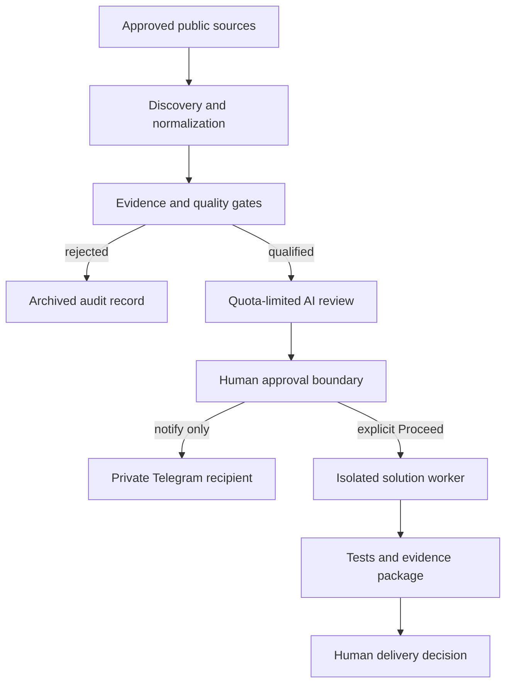

# Case Study: Bounty Autopilot Reliability Worker

## Overview

Bounty Autopilot is an owner-private workflow for discovering and reviewing public software bounty listings. Its purpose is to reduce false opportunities and missed quality listings while preserving human approval before any external action.

## System architecture

### Trust boundaries

| Boundary | Enforcement |
|---|---|
| Source ingestion | Only approved public sources; schema validation fails closed. |
| Worker identity | Heartbeats require the exact repository, collector identity, authentication, and 5/5 safety tests. |
| AI usage | Zero-price, quota-limited review runs only when cloud runtime configuration is live. |
| Notifications | Telegram sends only to the saved private recipient and suppresses duplicates. |
| External action | No claim, comment, build, pull request, submission, or maintainer contact without explicit human approval. |

## Problem

A keyword match is not enough to identify a valid bounty. An issue can remain open even when:

- the underlying work is already complete,
- a pull request has already been merged,
- the issue is only requesting payment,
- another contributor is actively working on it, or
- the listing lacks clear acceptance or reward evidence.

Treating those records as available work wastes time and damages trust.

## Implemented approach

### Evidence collection

The worker gathers structured evidence for each candidate and validates the expected schema before it can influence the dashboard.

### Quality gates

Candidates are screened for:

- open and unresolved work,
- explicit reward evidence,
- linked fixes or competing pull requests,
- completion and payment signals,
- repository activity and maintainership,
- sufficient technical context,
- duplicate notifications.

### Safe execution boundary

The system may discover, classify, and notify. It does not automatically:

- claim an issue,
- contact a maintainer,
- post a comment,
- build a bounty solution,
- create a pull request, or
- submit work for payment.

Those actions require a separate, explicit human decision.

### Worker verification

The connected worker currently passes **5 of 5 safety tests** covering evidence validation and execution boundaries. Heartbeats are authenticated, and the private dashboard rejects untrusted worker reports.

### Notification behavior

Telegram is configured to notify only when a new candidate passes the required gates. No candidate means no message, which prevents duplicate and low-quality alerts.

## Example false-positive prevented

An open GitHub issue titled as a bounty payment-status request referenced **7 already merged pull requests** and **$535** in advertised rewards. Although it contained bounty keywords and remained open, it was not unfinished work. The deeper validation rejected it, and a dedicated filter now prevents this class of issue from being shown as an opportunity.

## Current boundaries

- The operational dashboard and worker repository are private.
- Discovery does not prove that a sponsor will select or pay a submission.
- Test results apply to the worker's safety checks, not to future bounty acceptance.
- New sources are not marked connected until their live schema and authorization path are verified.
- Superteam agent discovery is not connected until its separate API identity and secret-handling path are explicitly authorized.

## Engineering principles demonstrated

- Structured evidence instead of keyword-only decisions
- Fail-closed validation
- Secret-safe authentication
- Explicit human approval boundaries
- Honest test and runtime reporting
- Auditability without public exposure of private recipient data
